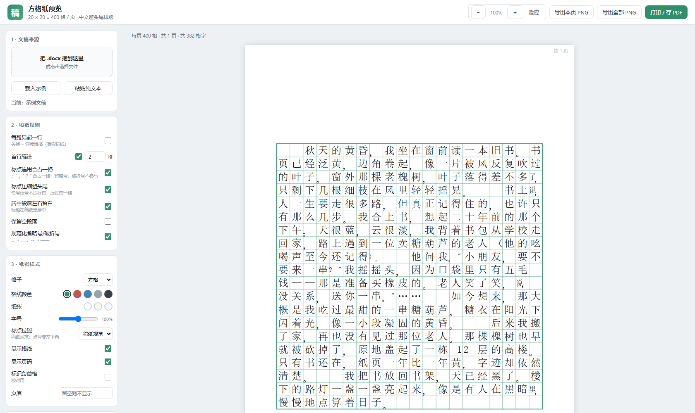
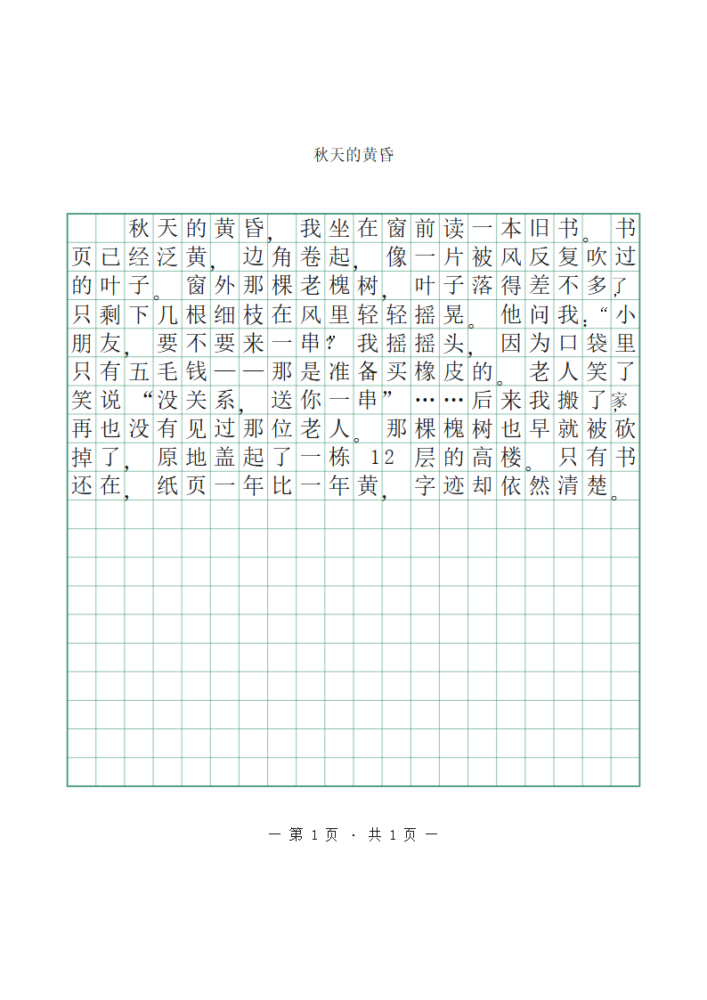

# 方格纸预览

[](./LICENSE)
[](https://github.com/LockhartANR/gaozhi-preview/actions/workflows/ci.yml)


把 Word（`.docx`）或粘贴的中文正文，按 **20 × 20 = 400 格/页** 的方格纸排版并预览，
可导出 PDF / PNG，也能打包成 3 MB 的 Windows 桌面应用。

纯前端，**文稿不上传**，解析和排版全在本地完成。



## 下载

Windows 桌面版（安装版 / 免安装版）见 **[Releases](https://github.com/LockhartANR/gaozhi-preview/releases/latest)**。

也可以自己构建：`pnpm build:standalone` 出单文件 HTML，`pnpm desktop:build` 出 exe。

## 快速开始

```bash
pnpm install
pnpm dev        # http://127.0.0.1:5273
pnpm test       # 排版引擎自检（29 项）
```

把 `.docx` 拖进窗口任意位置即可，仓库里的 `public/sample.docx` 可以直接拿来试。

## 它做对了什么

不是"20 个汉字换行"，而是**稿纸自己的排版规则**：

| | |
| --- | --- |
| 半角两字合一格 | `一栋 12 层` 里的 `12` 只占一格；数字、西文单词不拆行 |
| 标点连用合占一格 | `：“` `。”` `？”` 写在同一个格子里 |
| 行首 / 行尾禁则 | 句号不顶行首（压缩进前一格），左括号不挂行尾 |
| 标点按规范定位 | 点号靠格子左下角，引号、括号按方向靠边 |
| 段落连续填格 | 靠"段首空两格"分段，不另起一行 |
| 每 400 格翻页 | 一段可以跨页 |



完整规则、各地做法差异、尚未实现的部分见 **[docs/稿纸规则.md](docs/稿纸规则.md)**。

## 打包

| 目标 | 命令 | 产物 |
| --- | --- | --- |
| 网页 | `pnpm dev` | — |
| 单文件 HTML | `pnpm build:standalone` | `dist/方格纸预览.html`（347 KB，双击即用，不需要服务器） |
| 桌面应用 | `pnpm desktop:build` | exe 3 MB + NSIS 安装程序 |

桌面版用系统自带的 WebView2，不打包 Chromium，所以只有 3 MB。需要 Rust + MSVC 生成工具。

## 开发

`pnpm test` 在终端直接打印 20×20 网格，不打开浏览器就能核对断行和避头尾：

```
 3|的   叶   子   。   窗   外   那   棵   老   槐   树   ，   叶   子   落   得   差   不   多   了+， |
```

`+，` 表示这个逗号不能顶行首，被压缩进了前一格。

架构、目录结构、测试写法、环境注意事项（含 Windows/pnpm 的坑）见
**[docs/开发.md](docs/开发.md)**。

## License

[MIT](./LICENSE) © 2026 LockhartANR
