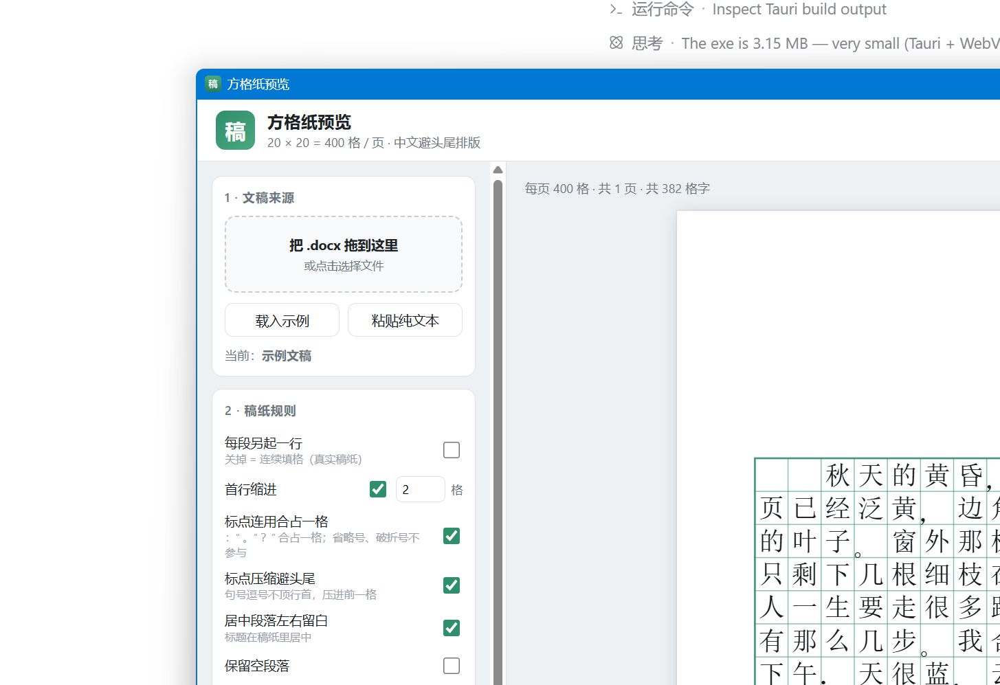

# 方格纸预览

[](./LICENSE)
[](https://github.com/LockhartANR/gaozhi-preview/actions/workflows/ci.yml)


把 Word（`.docx`）或粘贴的中文正文，按 **20 × 20 = 400 格/页** 的方格纸（稿纸）排版并预览，
支持打印导出 PDF、导出每页 PNG，也能打成 3 MB 的 Windows 桌面应用。

纯前端，没有后端，**文稿不上传**——解析和排版全在本地完成。


## 它解决什么问题

中文写作场景里"稿纸"是个绕不开的参照：一篇作文够不够 800 字、论文排版后大概几页、
给刊物投稿要写多少格。但在 Word 里你没法直接看到这个结果——Word 的页面视图和方格纸
是两套完全不同的排版模型。

这个项目把**稿纸自己的排版规则**实现了一遍，所以看到的不只是"20 个汉字换行"，
而是真实稿纸的样子：


## 快速开始

```bash
pnpm install
pnpm dev        # http://127.0.0.1:5273
pnpm test       # 排版引擎自检（26 项）+ 终端网格预览
pnpm build      # 类型检查 + 打包
```

打开后自带示例文稿，侧栏可以直接拖入 `.docx`。仓库里有一个现成的测试文档
`public/sample.docx`（含居中标题、首行缩进、软回车、表格、图片），可以直接拖进去看解析效果。

## 稿纸规则

真正难的不是画格子，而是把文字流翻译成**格位**。下面这些规则都实现成了纯函数
（`src/core/typeset.ts`），可以单测、可以单独复用：

| 规则 | 说明 |
| --- | --- |
| 全角占 1 格、**连续半角 2 个合 1 格** | `2024` 占两格，`一栋 12 层` 里的 `12` 只占一格 |
| **数字 / 西文单词不拆行** | `2024` 不会断成 `20` / `24`，`manuscript` 不会被切开；放不下就整组退到下一行 |
| **两个标点连用合占一格** | `：“` `。”` `？”` `！”` 等相邻标点合占一格；`……` `——` 各占两格、不参与，但引号可挤进省略号的第二格 |
| **行首禁则** | `。，、；：？！）】》」』` 等不能顶行首 —— 点号压缩进前一格，占两格的 `……` `——` 改用移字 |
| **行尾禁则** | `（【《「『` 等不能挂行尾，把该字退回下一行 |
| **间隔号 `·` 两侧都禁** | 人名不会从中间断开 |
| **半角括号 `()[]{}` 同守禁则** | 中文里混用半角括号时同样处理 |
| **标点写在格子的规范位置** | 点号（`。，、；：`）靠**左下角**，`？！` 在左半格中间，前引号/前括号靠右、后引号/后括号靠左 |
| **一格两个字形时按半格分治** | 标点+字、标点+标点合占时，这一格当两半格用，每个字形在自己那一半里继续按规范落位 |
| `……`、`——` 各占 2 格且不可拆行 | 合并成原子单元，断行时整体移动 |
| 首行缩进 2 格 | 读 docx 的 `w:ind/@w:firstLineChars`，读不到就按默认字号折算 twips |
| 段落**连续填格**（不另起行） | 默认行为，可切换成"每段另起一行" |
| **居中/右对齐段落独占一行** | 标题不会被正文接着写在同一行 |
| 软回车强制断行 | 识别 docx 的 `<w:br/>` |
| 每 400 格翻页，**一段可跨页** | 按行切页，20 行 × 20 格 = 400 格 |


上图能看到：`：“` 合占一格、行尾的 `，` 被压缩进前一格、点号沉在各自格子的左下角。

## 三种用法

| 用法 | 命令 | 产物 | 需要什么 |
| --- | --- | --- | --- |
| 网页 | `pnpm dev` | — | Node |
| **单文件 HTML** | `pnpm build:standalone` | `dist/方格纸预览.html`（347 KB） | 无，双击即用 |
| **桌面应用** | `pnpm desktop:build` | exe 3.15 MB + 安装程序 1.28 MB | Rust + MSVC + WebView2 |

### 单文件 HTML

```bash
pnpm build:standalone
```

产出一个含全部 JS/CSS 的 HTML，**双击就能用**，不需要 Node、不需要服务器、不联网，
可以直接拷到 U 盘或别的电脑。

> 为什么不能直接双击 `dist/index.html`：`file://` 下浏览器会以 CORS 为由拒绝加载**外链的**
> module 脚本，所以那个会白屏。`scripts/build-standalone.mjs` 把 JS/CSS 内联进 HTML 就没这问题了。

顺带有一个 `启动应用.cmd`：用 Chrome/Edge 的 `--app` 模式打开单文件，
得到**没有地址栏和标签页的独立窗口**。没装 Chrome/Edge 时自动退回默认浏览器。

### 桌面应用（Tauri）

```bash
pnpm desktop:exe     # 只出 exe，最快
pnpm desktop:build   # exe + NSIS 安装程序
pnpm desktop:dev     # 开发模式，改前端即时生效
```



用系统自带的 WebView2，不打包 Chromium，所以只有 3.15 MB。界面完全复用 `dist/` 里的静态文件，
Rust 那侧只负责开窗口（`src-tauri/src/lib.rs` 一共十行）。

> 若启动时报 `Failed to setup app: 拒绝访问 (os error 5)`：这是**运行环境的权限问题**，
> 不是应用问题——WebView2 需要在 `%LOCALAPPDATA%` 下建数据目录并设置 ACL，
> 被安全软件或受限沙箱挡住时会这样。规避方法：把环境变量 `WEBVIEW2_USER_DATA_FOLDER`
> 指向一个可写目录。

## 架构

```
docx 文件
  └─ core/docx.ts        JSZip 直接解 word/document.xml（拿得到软回车/缩进/对齐，
                        比 mammoth 之类的转换层更可控；表格、图片、公式会给出提示）
      └─ DocParagraph[]
          └─ core/typeset.ts   ★ 排版引擎，纯函数、无 DOM 依赖
              ├─ toUnits()      段落 → 字符单元（缩进、软回车、原子标点、词组分组）
              ├─ buildLines()   贪心填 20 格 + 避头尾修正 → Cell[][]
              └─ paginate()     每 20 行切一页 → Page[]（每页恒 400 个格子）
                  └─ core/svg.ts    pageToSvg()：一页 → SVG
                      ├─ 屏幕预览  PageSheet 直接注入这段 SVG
                      ├─ 打印 PDF  @media print，一页 A4 一张稿纸
                      └─ 导出 PNG  SVG →  → canvas → PNG（或打包 zip）
```

**一个关键取舍：预览和导出共用同一个 `pageToSvg()`。** 屏幕上看到的、打印出来的、
导出的 PNG 是同一段代码生成的，不会出现"预览是对的、导出跑版了"。

## 目录结构

```
src/core/         排版引擎（无 DOM 依赖，可在 Node 里单测）
  east-asian.ts     字宽判定、禁则表、标点锚点
  typeset.ts        排版主流程
  docx.ts           .docx 解析
  svg.ts            页面 → SVG
  layout.ts         A4 与格子的几何常量（CSS 用 mm，SVG 按 96dpi 换算）
src/components/   PageSheet / Sidebar
src/exporters/    PNG + zip 导出
src/verify.ts     开发用校验页（配合 verify.html 使用）
scripts/
  test-typeset.ts      自检 + 终端网格预览
  build-standalone.mjs 打包单文件 HTML
  make-sample-docx.py  生成 public/sample.docx（手写 OOXML，不依赖 Office）
  make-icon.py         生成桌面应用图标
src-tauri/        Tauri 桌面外壳
public/sample.docx
```

## 开发

`pnpm test` 会直接跑引擎自检，并在终端打印 20×20 的网格，不打开浏览器就能核对断行和避头尾：

```
 1|·   ·   秋   天   的   黄   昏   ，   我   坐   在   窗   前   读   一   本   旧   书   。   书   |
 ...
 3|的   叶   子   。   窗   外   那   棵   老   槐   树   ，   叶   子   落   得   差   不   多   了+， |
 9|早   就   被   砍   掉   了   ，   原   地   盖   起   了   一   栋       2   层   的   高   楼+。 |
```

`+，` 表示这个逗号因为不能顶到下一行行首，被压缩进了前一格。

另外还有一个校验页：`pnpm dev` 之后打开 <http://127.0.0.1:5273/verify.html>，
它会拉取 `public/sample.docx`，把解析出的段落和排版结果并排打出来。

## 已知边界

**做法各地不一致的**（都做成了开关，默认按最常见做法）：

- **标点位置**：默认"稿纸规范"（点号靠左下角）。也有不少作文本是把标点居中的，可以切。
- **标点连用合占一格**：默认开。这条规则原文是"**可以**合占"，不是"必须"。

**尚未实现的规则**：

- **着重号**（字下加点）和**专名号**（字下划线）：标在字的下面，本身不占格。docx 里对应 `<w:em>`。
- **手动分页符**：目前忽略，只在侧栏提示。
- **半角标点自动转全角**：现在只规范化了 `...` → `……`、`--` → `——`。
- **标点配对检查**：引号/括号不配对时给个校对警告。
- **竖排稿纸**：点号位置、引号方向、破折号方向都要镜像。
- **段首引号是否与缩进共占一格**：有"引号顶格写"的做法，各地不一。

**其他**：

- **图片、公式不排版**，只在侧栏提示数量；表格会提取单元格文字，但不保留表格结构。
- `.doc`（旧二进制格式）不支持，需先另存为 `.docx`。
- 长文档（>50 页）首屏靠 `IntersectionObserver` 只渲染视口附近的页；打印前会全部渲染。

## 环境注意事项

**Windows + pnpm**：pnpm 默认用 junction 组织 `node_modules`，而 Node 的 ESM 解析器
不穿透 junction，`vite` 会报 `Cannot find package 'rollup'`。本项目在 `pnpm-workspace.yaml`
里设了 `nodeLinker: hoisted` 绕开。同时关掉了 `minimumReleaseAge`（联网策略校验，
在国内网络下会把安装拖到超时）。

**Node 版本**：`pnpm test` 直接跑 `.ts` 文件，依赖 Node 原生类型擦除，需要 **Node ≥ 22.18**。

## 后续可以做的

1. **导出稿纸版 .docx**：每页一个 20×20 表格，产物可继续在 Word 里编辑。
2. 字数统计口径切换：按格 / 按字符（不含标点）/ 纯中文字符数。
3. 段落级交互：点格子跳到原文，改一个字只重排后面（增量排版）。
4. 自定义纸张与格子尺寸（16K、每行 25 格、竖排）。
5. 关联 `.docx` 文件类型，双击文档直接用桌面应用打开。

## License

[MIT](./LICENSE) © 2026 LockhartANR
