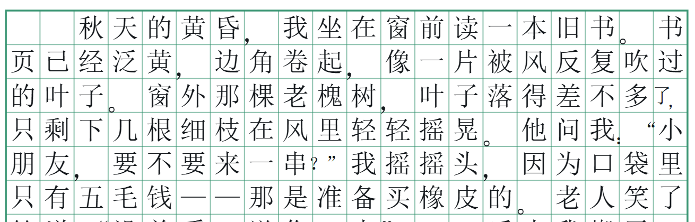

# 稿纸排版规则

这个项目实现的是**稿纸自己的排版规则**，不是简单的"20 个汉字换行"。
规则都在 `src/core/typeset.ts` 和 `src/core/east-asian.ts` 里，做成了无 DOM 依赖的纯函数。

## 已实现

| 规则 | 说明 |
| --- | --- |
| 全角占 1 格、连续半角 2 个合 1 格 | `2024` 占两格，`一栋 12 层` 里的 `12` 只占一格 |
| 数字 / 西文单词不拆行 | `2024` 不会断成 `20` / `24`，`manuscript` 不会被切开；放不下就整组退到下一行 |
| 两个标点连用合占一格 | `：“` `。”` `？”` `！”` 等相邻标点合占一格；`……` `——` 各占两格、不参与，但引号可挤进省略号的第二格 |
| 行首禁则 | `。，、；：？！）】》」』` 等不能顶行首 —— 点号压缩进前一格，占两格的 `……` `——` 改用移字 |
| 行尾禁则 | `（【《「『` 等不能挂行尾，把该字退回下一行 |
| 间隔号 `·` 两侧都禁 | 人名不会从中间断开 |
| 半角括号 `()[]{}` 同守禁则 | 中文里混用半角括号时同样处理 |
| 标点写在格子的规范位置 | 点号（`。，、；：`）靠**左下角**，`？！` 在左半格中间，前引号/前括号靠右、后引号/后括号靠左 |
| 一格两个字形时按半格分治 | 标点+字、标点+标点合占时，这一格当两半格用，每个字形在自己那一半里继续按规范落位 |
| `……`、`——` 各占 2 格且不可拆行 | 合并成原子单元，断行时整体移动 |
| 首行缩进 2 格 | 读 docx 的 `w:ind/@w:firstLineChars`，读不到就按默认字号折算 twips |
| 段落连续填格（不另起行） | 默认行为，可切换成"每段另起一行" |
| 居中/右对齐段落独占一行 | 标题不会被正文接着写在同一行 |
| 软回车强制断行 | 识别 docx 的 `<w:br/>` |
| 每 400 格翻页，一段可跨页 | 按行切页，20 行 × 20 格 = 400 格 |



上图能看到：`：“` 合占一格、行尾的 `，` 被压缩进前一格、点号沉在各自格子的左下角。

### 关于"标点连用合占一格"

- 规则：**相邻的两个标点合占一格**（`：“` `。”` `？”` `！”` `，”` …），不分点号和标号、不分前后。
- 例外：`……` 和 `——` 各占两格，**不能**作为被合占的那一个；但引号可以挤进省略号的第二个格子（`……”`）。
- 合占之后这一对是一个整体，断行时不会被打散到两行。
- 这条规则和"避头尾"是两件事：合占是常规写法（随时生效），避头尾只在标点正好落到行首时才触发。
- 侧栏可以单独关掉。

### 一个容易踩的坑：按"格"而不是按"宽度"判断

半角字符后面跟全角字符时，那个半角字符独占半格、**另外半格是浪费的**：

```
第 A 章  →  宽度 2.5，实际要占 3 格
```

所以"这一行放不放得下"必须按**格子数**算。曾经按宽度和算，导致过两个 bug：
右对齐补空格时末字被顶到下一行；以及宽度和 ≤ 20 但装箱需要 21 格时，最后一个字被静默丢弃。
现在统一用 `packOf()` 装箱规则数格子，作为唯一判据。

## 做法各地不一致的

都做成了开关，默认按最常见做法：

- **标点位置**：默认"稿纸规范"（点号靠左下角）。也有不少作文本是把标点居中的，可以切。
- **标点连用合占一格**：默认开。这条规则原文是"**可以**合占"，不是"必须"。

## 尚未实现的规则

- **着重号**（字下加点）和**专名号**（字下划线）：标在字的下面，本身不占格。docx 里对应 `<w:em>`。
- **手动分页符**：目前忽略，只在侧栏提示。
- **半角标点自动转全角**：现在只规范化了 `...` → `……`、`--` → `——`。
- **标点配对检查**：引号/括号不配对时给个校对警告。
- **竖排稿纸**：点号位置、引号方向、破折号方向都要镜像。
- **段首引号是否与缩进共占一格**：有"引号顶格写"的做法，各地不一。

## 其他边界

- **图片、公式不排版**，只在侧栏提示数量；表格会提取单元格文字，但不保留表格结构。
- `.doc`（旧二进制格式）不支持，需先另存为 `.docx`。
- 长文档（>50 页）首屏靠 `IntersectionObserver` 只渲染视口附近的页；打印前会全部渲染。

## 后续可以做的

1. **导出稿纸版 .docx**：每页一个 20×20 表格，产物可继续在 Word 里编辑。
2. 字数统计口径切换：按格 / 按字符（不含标点）/ 纯中文字符数。
3. 段落级交互：点格子跳到原文，改一个字只重排后面（增量排版）。
4. 自定义纸张与格子尺寸（16K、每行 25 格、竖排）。
5. 关联 `.docx` 文件类型，双击文档直接用桌面应用打开。
